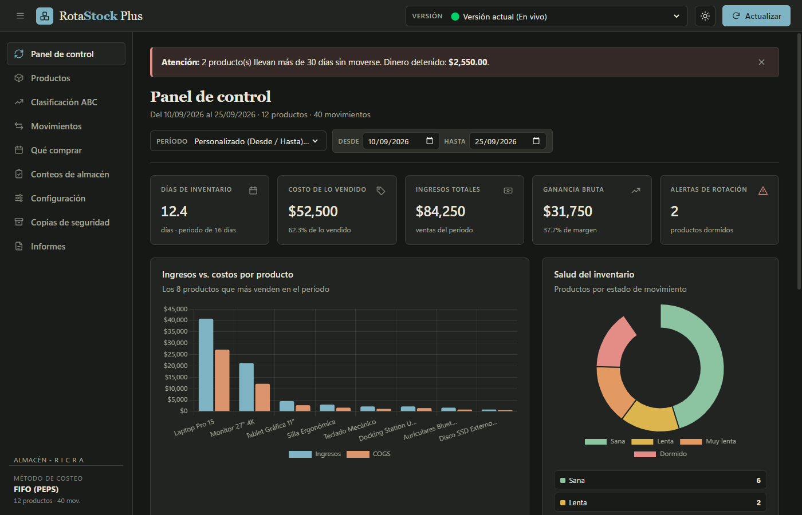
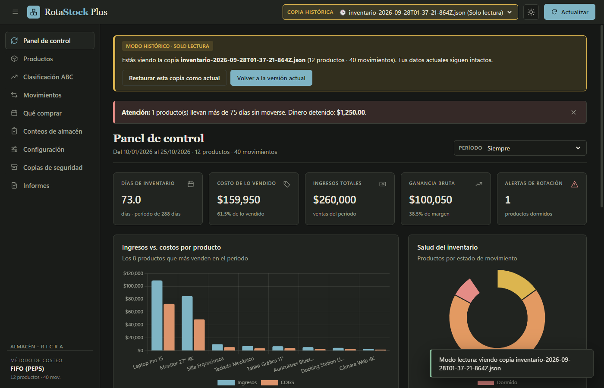
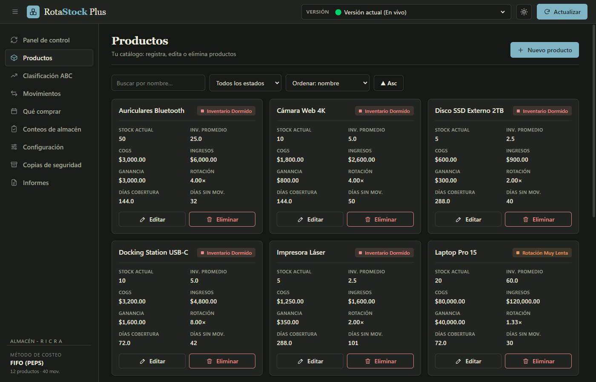
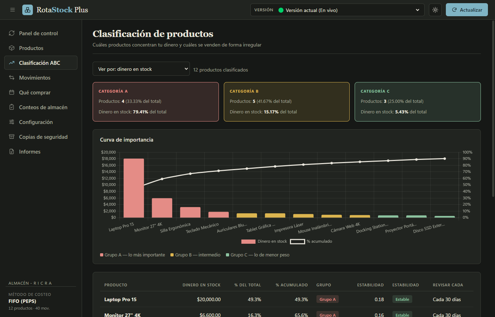
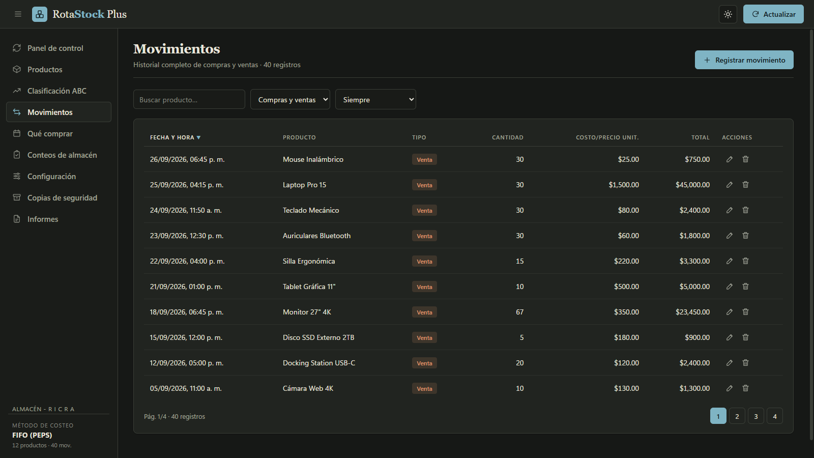
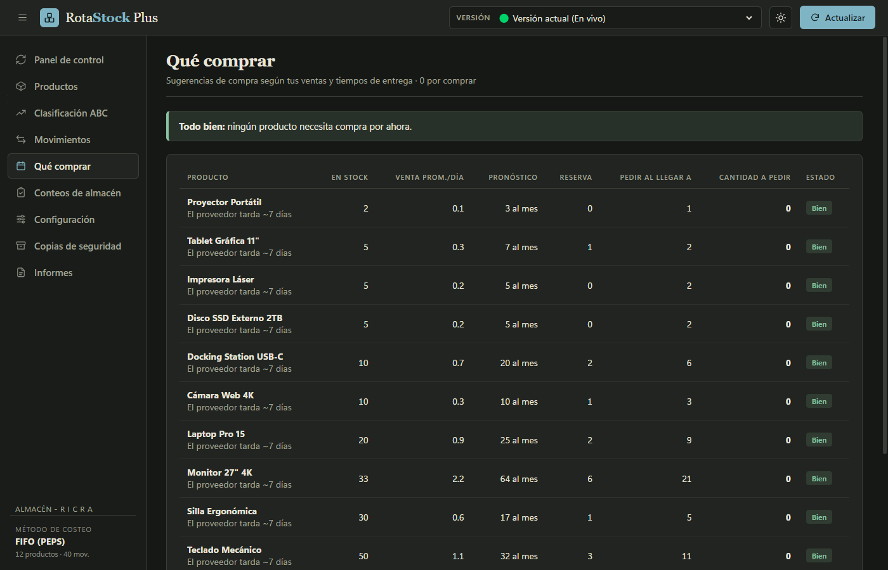
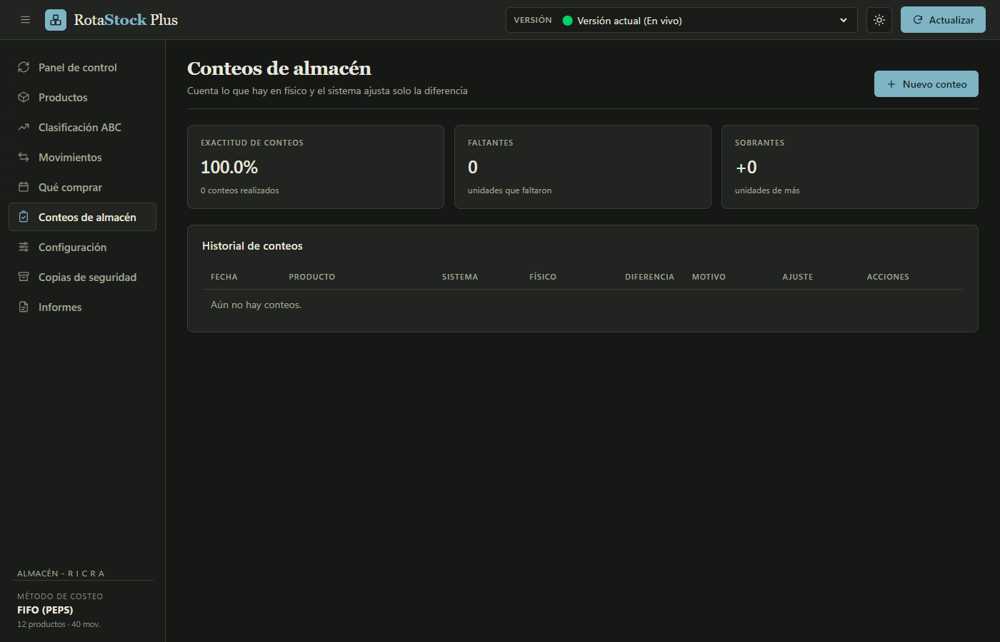
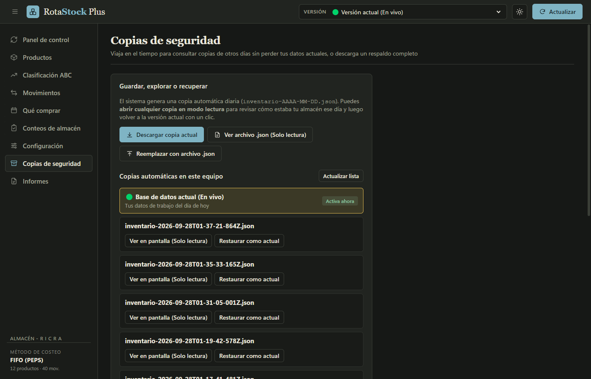

# RotaStock Plus — Control de Inventario FIFO y Gestión de Almacén

> Aplicación de escritorio para Windows basada en Electron para el control de inventario valorado mediante el método FIFO estricto (PEPS), clasificación ABC/XYZ, planificación de compras, auditoría física, modo viaje en el tiempo sobre copias históricas y reportes ejecutivos en PDF y Excel, 100% offline con doble persistencia atómica en JSON y SQLite.

<p align="center">
  
  
  
  
  
  
  
  
</p>

<p align="center">
  
  <br>
  
  <br>
  
  <br>
  
  
</p>

El encargado de compras o administrador del almacén registra las órdenes de compra y los despachos diarios; el sistema recalcula en tiempo real el valor remanente de cada lote y la rotación financiera en cualquier ventana de fechas configurada (`Hoy`, `Este mes`, `Siempre` o un rango exacto `Desde / Hasta`). Paralelamente, los auditores de almacén efectúan conteos cíclicos contrastando el inventario físico contra el sistema y pueden inspeccionar copias automáticas de días anteriores en modo de solo lectura sin alterar la base de datos activa.

---

## Tabla de contenidos

- [Descripción](#descripción)
- [Módulos del sistema](#módulos-del-sistema)
- [Descarga y distribución](#descarga-y-distribución)
- [Características principales](#características-principales)
- [Stack tecnológico](#stack-tecnológico)
- [Arquitectura](#arquitectura)
- [Canales de comunicación IPC](#canales-de-comunicación-ipc)
- [Motor FIFO y clasificación ABC](#motor-fifo-y-clasificación-abc)
- [Instalación y uso](#instalación-y-uso)
- [Requisitos del sistema](#requisitos-del-sistema)
- [Persistencia, integridad y copias de seguridad](#persistencia-integridad-y-copias-de-seguridad)
- [Verificación y pruebas automatizadas](#verificación-y-pruebas-automatizadas)
- [Buenas prácticas de uso](#buenas-prácticas-de-uso)
- [Roadmap](#roadmap)
- [Licencia](#licencia)
- [Autor](#autor)

---

## Descripción

En almacenes comerciales y de suministros, un mismo artículo suele adquirirse a precios unitarios fluctuantes debido a inflación, variación cambiaria, promociones por volumen o cambio de proveedor. Los sistemas tradicionales de costo promedio ponderado ocultan el margen real de cada venta y complican el control fiscal de existencias.

**RotaStock Plus** resuelve esta problemática implementando un modelo estricto de **Primeras Entradas, Primeras Salidas (FIFO / PEPS)** con seguimiento individual de capas de inventario. El operador registra únicamente la cantidad y el precio de venta al cliente; el motor desglosa automáticamente el costo de los bienes vendidos (COGS) consumiendo las unidades disponibles de los lotes más antiguos.

El sistema se diseñó bajo el principio de **Event Sourcing simplificado**: no almacena saldos ni indicadores financieros precalculados como fuente de verdad. El stock actual, los días de cobertura, la semaforización por inactividad y los pronósticos de reabastecimiento se reconstruyen mediante un *replay* determinista de toda la bitácora histórica hasta la fecha de corte seleccionada. La información se almacena con doble persistencia: un archivo JSON principal con escritura atómica para máxima portabilidad, acompañado por un espejo relacional SQLite transaccional (modo WAL) optimizado para grandes volúmenes de transacciones.

---

## Módulos del sistema

| # | Módulo | Función operativa |
|---|---|---|
| 01 | Panel de control | 5 tarjetas KPI (Días de inventario, COGS, Ingresos, Ganancia bruta, Alertas), gráficos interactivos (Ingresos vs. COGS y Dona de salud) y tabla paginada con selector de período (`Hoy`, `Este mes`, `Siempre` o rango personalizado `Desde / Hasta`). |
| 02 | Productos | Catálogo general de artículos con métricas individuales por tarjeta, buscador en tiempo real, filtro por estado de rotación y ordenamiento configurable. |
| 03 | Clasificación ABC / XYZ | Clasificación de Pareto con asignador heurístico por proximidad a los umbrales 80/95 (con desempate por promoción a la clase superior), análisis de estabilidad mensual por coeficiente de variación (XYZ) y frecuencias de revisión sugeridas. |
| 04 | Movimientos | Bitácora cronológica de entradas (compras y ajustes excedentes) y salidas (ventas y ajustes por faltante) con filtro por fechas (`Hoy`, `Este mes`, `Siempre` o `Desde / Hasta`) y control estricto que impide registrar salidas superiores al stock disponible. |
| 05 | Qué comprar | Modelo de reabastecimiento basado en suavizado exponencial ($\alpha = 0.3$), desviación diaria de demanda, stock de seguridad con factor $Z$ y punto de reorden según el tiempo de entrega del proveedor (`leadTime`) para sugerir cantidades de pedido exactas. |
| 06 | Conteos de almacén | Auditorías físicas periódicas con cálculo de discrepancia ($d = \text{físico} - \text{sistema}$), generación automática de movimientos de ajuste al costo promedio ponderado de capas vivas, reversión íntegra e índice de exactitud de registros de inventario (IRA %). |
| 07 | Configuración | Parametrización de los límites de días para la semaforización de inactividad (Sana, Lenta, Muy Lenta, Dormido) y personalización del nombre comercial de la empresa. |
| 08 | Copias de seguridad | Selector rápido en barra superior y panel de copias automáticas diarias (`inventario-YYYY-MM-DD.json`) con **Modo Viaje en el Tiempo (solo lectura)** para inspeccionar el estado pasado del almacén y regresar a la versión actual en un clic, además de exportación/importación manual. |
| 09 | Informes | Generación en el cliente de libros de cálculo Excel (`.xlsx`) de 4 hojas con fórmulas vivas de celda y reportes ejecutivos en PDF vectorial (`.pdf`) de 6 secciones para cualquier período o rango de fechas `Desde / Hasta`. |

---

## Descarga y distribución

| Paquete | Versión | Plataforma | Descripción | Enlace |
|---|---|---|---|---|
| Instalador oficial NSIS | `2.0.2` | Windows 10/11 (x64) | Asistente de instalación estándar (`RotaStockPlus Setup 2.0.2.exe`) con accesos directos y desinstalador | [Releases de RotaStock Plus](https://github.com/TeVerde29/RotaStock-Plus/releases/latest) |
| Ejecutable portable | `2.0.2` | Windows 10/11 (x64) | Binario autónomo sin instalación (`RotaStockPlus.exe`) | [Releases de RotaStock Plus](https://github.com/TeVerde29/RotaStock-Plus/releases/latest) |

---

## Características principales

- **Motor de replay FIFO estricto:** Reconstruye la cola de lotes en cada cálculo. Si un producto cuenta con capas a diferentes precios, la venta liquida primero el lote más antiguo y continúa con los siguientes sin promedios artificiales.
- **Modo Viaje en el Tiempo (copias en solo lectura):** Permite abrir cualquier copia automática diaria (`inventario-YYYY-MM-DD.json`) o archivo `.json` externo directamente desde la barra superior para consultar indicadores, tablas o exportar reportes de esa fecha sin sobrescribir la base de datos en vivo, bloqueando ediciones accidentales hasta pulsar «Volver a la versión actual».
- ** Ventanas de tiempo y fechas personalizadas (`Desde / Hasta`):** Tanto el Panel de control como Movimientos e Informes permiten alternar entre `Hoy`, `Este mes (30 días)`, `Siempre` o un rango exacto `Desde` y `Hasta`, calculando el estado y las capas FIFO al corte del día final elegido.
- **Doble persistencia atómica (JSON + SQLite WAL):** Las operaciones de guardado se escriben primero en archivos temporales con volcado físico `fsync` antes de renombrar, y se sincronizan dentro de una transacción ACID (`BEGIN IMMEDIATE ... COMMIT`) en `inventario.sqlite`.
- **Clasificación ABC heurística por proximidad:** Evita saltos rígidos en las fronteras del 80% y 95%. Si la distancia porcentual al umbral es simétrica, promueve el producto a la categoría de mayor prioridad.
- **Análisis de estabilidad XYZ:** Calcula el coeficiente de variación poblacional sobre la demanda agrupada por mes calendario para categorizar artículos en estables (X), variables (Y) e irregulares (Z).
- **Modelo de punto de reorden dinámico:** Determina el stock de seguridad considerando la variabilidad conjunta de la demanda y el tiempo de entrega del proveedor (`leadTime`).
- **Conteos físicos integrados:** Las auditorías reconcilian el almacén insertando movimientos de venta (faltantes) o compra (sobrantes) valorados al costo real de capas vivas, permitiendo editar o revertir cualquier conteo sin dejar desalineaciones en la bitácora.
- **Seguridad en Electron:** Confinamiento mediante `contextIsolation: true`, `nodeIntegration: false`, `sandbox: true` y una política de seguridad de contenido (`Content-Security-Policy`) estricta sin scripts inline.
- **Renderizado perezoso (Lazy Rendering):** El cálculo de indicadores se realiza de forma centralizada pero el renderizado visual en el DOM solo procesa la pestaña visible en pantalla, acelerando la navegación.
- **Operación 100% offline:** Todas las librerías gráficas y de exportación se encuentran empaquetadas localmente (`frontend/assets/vendor/`). No requiere conexión a internet para funcionar.

---

## Stack tecnológico

| Capa | Tecnología | Versión | Función en el sistema |
|---|---|---|---|
| Entorno de escritorio | Electron | 30.5.1 | Proceso principal, gestión de ventanas y ciclo de vida en Windows |
| Empaquetador | electron-builder | 24.13.3 | Generación del instalador NSIS (`2.0.2`) y versión portable x64 |
| Puente IPC | Electron contextBridge | 30.5.1 | Aislamiento de contexto seguro entre `main.js` y el renderer |
| Persistencia primaria | JSON (escritura atómica) | Esquema 2.0.2 | Almacenamiento portátil y fuente de exportación |
| Persistencia secundaria | SQLite (modo WAL) | Node.js nativo | Espejo transaccional indexado para consultas de alto volumen |
| Frontend | HTML5 / CSS3 / JavaScript | ES2022 | Interfaz modular en cliente sin frameworks pesados |
| Gráficos interactivos | Chart.js | 4.4.0 (UMD) | Gráficos de barras, dona de rotación y curva de Pareto |
| Generación de hojas de cálculo | SheetJS (xlsx) | 0.18.5 (Full) | Libro Excel con fórmulas dinámicas (`SUM`, productos de celda) |
| Generación de documentos PDF | jsPDF + AutoTable | 2.5.1 / 3.5.31 | Maquetación vectorial A4 de informes ejecutivos |
| Entorno de pruebas | Node.js Test Runner | 22.x nativo | Suite automatizada de 11 pruebas unitarias y de integración |

---

## Arquitectura

```
RotaStock-Plus/
 ├── main.js                      # Proceso principal: IPC, ventanas, copias y arranque
 ├── preload.js                   # Exposición segura en window.rotastock mediante contextBridge
 ├── package.json                 # Metadatos (v2.0.2), dependencias, scripts y configuración de build
 ├── funcionalidades.md           # Especificación matemática exhaustiva y manual de replicación
 ├── build/
 │    ├── icon.ico                # Ícono oficial del ejecutable de Windows e instalador
 │    └── icon.png                # Ícono en alta resolución para accesos directos
 ├── src/
 │    ├── validator.js            # Validación de esquema JSON y reglas de negocio
 │    ├── atomic-fs.js            # Escritura atómica a disco con fsync y rename
 │    ├── sqlite-store.js         # Espejo transaccional SQLite con índices relacionales
 │    └── updater.js              # Controlador de actualizaciones automáticas con fallback offline
 ├── scripts/
 │    └── sign-windows.js         # Hook de firma digital Authenticode con signtool
 ├── frontend/
 │    ├── index.html              # Estructura de la aplicación de una sola página (SPA)
 │    ├── style.css               # Sistema de diseño con variables para temas oscuro y claro
 │    ├── theme-init.js           # Inicialización inmediata de tema antes del primer render
 │    ├── constants.js            # Constantes de dominio, formatos numéricos y utilidades
 │    ├── store.js                # Cascada híbrida de persistencia y Modo Viaje en el Tiempo
 │    ├── engine.js               # Motor matemático FIFO, rangos Desde/Hasta, ABC, XYZ y Reabastecimiento
 │    ├── reports.js              # Generador de libros Excel y reportes PDF
 │    ├── app.js                  # Controlador de interfaz, estado global y navegación
 │    └── assets/
 │         ├── icon.png           # Logotipo de la aplicación
 │         └── vendor/            # Chart.js, SheetJS, jsPDF y AutoTable locales
 ├── img/                         # Capturas reales de las vistas del sistema v2.0.2
 ├── tests/
 │    └── funcionalidades.test.js # Suite de 11 pruebas automatizadas contra funcionalidades.md
 ├── datos/
 │    └── inventario.json         # Semilla inicial de datos para primera ejecución
 └── backups/                     # Carpeta de copias de seguridad automáticas diarias
```

### Decisiones arquitectónicas fundamentales

- **Persistencia en Roaming:** En modo instalado, los datos no se guardan en la carpeta de instalación (donde Windows requiere permisos elevados), sino en el directorio de perfil del usuario: `C:\Users\<usuario>\AppData\Roaming\RotaStockPlus\`.
- **Escritura a prueba de fallos:** La función `writeFileAtomicSync` escribe primero en un archivo temporal con sufijo de proceso y marca de tiempo; tras validar el cierre del descriptor y sincronizar con el disco, ejecuta un reemplazo atómico que evita archivos corruptos ante cortes de energía.
- **Modo lectura aislado en memoria:** Al activar `Store.previewSnapshot()`, el estado actual se preserva en `Store.liveDb` y `Store.save()` bloquea cualquier escritura en disco hasta que el usuario salga de la vista previa o confirme explícitamente la restauración.
- **Aislamiento en módulos auto-ejecutables:** Los archivos de lógica del frontend (`constants.js`, `store.js`, `engine.js`, `reports.js`, `app.js`) están encapsulados en funciones auto-ejecutables (IIFE) que exportan selectivamente sus interfaces a `globalThis` y a `module.exports`, permitiendo ejecutar pruebas nativas con Node.js sin alterar la ejecución en el navegador.

---

## Canales de comunicación IPC

El proceso de renderizado interactúa con el proceso principal de Electron exclusivamente a través de los métodos expuestos en `window.rotastock`:

```javascript
// Métodos disponibles en el objeto seguro window.rotastock
window.rotastock.loadDB();              // Invoca canal 'db:load' para leer inventario.json
window.rotastock.saveDB(jsonText);       // Invoca canal 'db:save' (valida y guarda de forma atómica)
window.rotastock.listBackups();          // Invoca canal 'db:listBackups' (lista copias diarias)
window.rotastock.readBackup(fileName);   // Invoca canal 'db:readBackup' (lee copia sanitizada)
window.rotastock.sqliteStatus();         // Invoca canal 'db:sqliteStatus' (diagnóstico SQLite)
window.rotastock.checkForUpdates();      // Invoca canal 'app:checkForUpdates' (consulta de versiones)
```

---

## Motor FIFO y clasificación ABC

### Dinámica de capas FIFO multi-precio

Cuando se procesa una venta, el motor toma las unidades del lote de compra más antiguo en la cola del producto. Si la transacción supera la cantidad disponible en dicho lote, agota la capa con su costo unitario original y consume el remanente del lote subsiguiente:

$$\text{COGS}_{\text{venta}} = \sum_{i} \left( \text{unidades\_tomadas}_i \times \text{costo\_unitario}_i \right)$$

$$\text{Ingreso}_{\text{venta}} = \text{cantidad\_vendida} \times \text{precio\_venta}$$

$$\text{Ganancia\_bruta} = \text{Ingreso}_{\text{venta}} - \text{COGS}_{\text{venta}}$$

### Asignador heurístico por proximidad

A diferencia de los cortes rígidos tradicionales en los percentiles 80% y 95%, RotaStock Plus compara la distancia absoluta al umbral antes y después de incluir el producto $i$:

$$\text{decide}(\text{antes}, \text{después}, \text{umbral}) = \begin{cases} 0 \quad (\text{permanece en clase superior}) & \text{si } (\text{después} - \text{umbral}) \le (\text{umbral} - \text{antes}) \\ 1 \quad (\text{pasa a clase siguiente}) & \text{si } (\text{después} - \text{umbral}) > (\text{umbral} - \text{antes}) \end{cases}$$

El operador $\le$ asegura que en caso de empate exacto de distancias, el producto se clasifique en la categoría de mayor criticidad (A o B).

---

## Instalación y uso

### Requisitos previos

- Node.js LTS (versión 20 o superior).
- Gestor de paquetes `npm`.

### Procedimiento para desarrollo

1. **Clonar el repositorio:**
   ```bash
   git clone https://github.com/TeVerde29/RotaStock-Plus.git
   cd RotaStock-Plus
   ```

2. **Instalar dependencias:**
   ```bash
   npm install
   ```

3. **Ejecutar pruebas unitarias y de verificación matemática:**
   ```bash
   npm test
   ```

4. **Iniciar en modo desarrollo:**
   ```bash
   npm start
   ```

5. **Compilar instalador y binario portable (`v2.0.2`):**
   ```bash
   npm run build
   ```
   Los archivos compilados se generarán en la carpeta `dist/` (`RotaStockPlus Setup 2.0.2.exe` y `RotaStockPlus.exe`).

### Flujo de trabajo operativo

1. **Catálogo:** Crear los productos definiendo su nombre, tiempo de entrega del proveedor (`leadTime`) y margen de seguridad estadístico ($Z$). Si se especifica un stock inicial, el sistema generará automáticamente su primer movimiento de compra.
2. **Movimientos:** Registrar las compras a sus costos unitarios reales y las ventas a sus respectivos precios de venta.
3. **Monitoreo por período o rango de fechas:** Consultar el Panel de Control eligiendo `Hoy`, `Este mes`, `Siempre` o `Personalizado (Desde / Hasta)` para verificar el índice de rotación, los días de cobertura y los productos en estado dormido.
4. **Reabastecimiento:** Revisar la vista *Qué comprar* para identificar artículos en alerta cuyo stock actual se encuentre igual o por debajo del punto de reorden.
5. **Auditoría:** Realizar conteos periódicos en el almacén físico; el sistema registrará de forma automática las discrepancias sin romper la valoración de las capas FIFO.
6. **Viaje en el tiempo y respaldos:** Usar el selector superior de versión o la vista *Copias de seguridad* para inspeccionar copias de días anteriores en modo lectura y regresar a la versión en vivo con un clic.
7. **Informes:** Emitir reportes en PDF o Excel según el período o rango de fechas `Desde / Hasta` deseado.

---

## Requisitos del sistema

| Componente | Requisito mínimo | Requisito recomendado |
|---|---|---|
| Procesador | Intel Core i3 / AMD Ryzen 3 (2.0 GHz) | Intel Core i5 / AMD Ryzen 5 o superior |
| Memoria RAM | 4 GB | 8 GB o superior |
| Almacenamiento libre | 250 MB | 500 MB (para histórico y respaldos) |
| Pantalla | Resolución 1024 × 640 píxeles | Resolución 1360 × 860 píxeles o superior |
| Sistema operativo | Windows 10 (x64) | Windows 11 (x64) |
| Conectividad | Ninguna requerida durante la operación | Opcional para descarga de dependencias |

---

## Persistencia, integridad y copias de seguridad

- **Ruta en Windows:** `%APPDATA%\RotaStockPlus\datos\inventario.json` y `inventario.sqlite`.
- **Copias automáticas diarias:** En el primer guardado de cada día, el proceso principal genera una instantánea en `%APPDATA%\RotaStockPlus\backups\inventario-YYYY-MM-DD.json`.
- **Política de retención inteligente:** Se depuran los respaldos que superen los 30 días de antigüedad, garantizando siempre la conservación de al menos las 15 copias más recientes.
- **Modo Viaje en el Tiempo:** Permite visualizar cualquier copia diaria o archivo `.json` externo en modo de solo lectura sin afectar la base de datos activa.
- **Exportación manual:** El módulo de copias permite descargar en cualquier momento el archivo `inventario_completo_YYYY-MM-DD.json` para transferir la base de datos entre terminales sin pérdida de información.

---

## Verificación y pruebas automatizadas

El proyecto cuenta con una batería de 11 pruebas unitarias que valida cada algoritmo e invariante definido en `funcionalidades.md`:

```bash
npm test
```

Salida de la verificación automatizada:
- **Subtest 1:** Línea base matemática con semilla real (`totCogs = 159950`, `totIng = 260000`, `totGan = 100050`, `totVal = 40550`).
- **Subtest 2:** Simulación multi-precio FIFO estricto (ejemplo numérico de la Sección 3.6).
- **Subtest 3:** Heurística ABC por proximidad, regla de empate y estabilidad XYZ.
- **Subtest 4:** Modelo de reabastecimiento (suavizado exponencial, cálculo de SS y PRO).
- **Subtest 5:** Ajustes automáticos de conteo físico e integridad de capas FIFO.
- **Subtest 6:** Generación de libro Excel con 4 hojas y fórmulas vivas de celda (`G6*D6`, `SUM`).
- **Subtest 7:** Validador de esquema JSON y escritura atómica en disco.
- **Subtest 8:** Persistencia relacional SQLite transaccional (sincronización y recuperación).
- **Subtest 9:** Confinamiento de seguridad, políticas CSP, sanitización y actualización offline (`v2.0.2`).
- **Subtest 10:** Rango de fechas personalizado (`Desde` y `Hasta`) con corte cronológico de capas FIFO y ordenamiento automático de fechas invertidas.
- **Subtest 11:** Modo Viaje en el Tiempo (previsualización de copias históricas en modo lectura, bloqueo de escritura en disco y retorno íntegro a la base en vivo).

---

## Buenas prácticas de uso

- **Evitar la edición directa de archivos:** No modifique manualmente los archivos `.json` ni `.sqlite` en el directorio de usuario; utilice siempre los módulos correspondientes dentro de la interfaz gráfica.
- **Costeo asistido:** En los movimientos de salida (ventas), ingrese el precio cobrado al cliente. No intente calcular el costo de la mercancía de forma manual; el motor FIFO asignará el costo exacto a partir de las capas vivas.
- **Consulta segura de copias:** Cuando necesite verificar cómo estaba el inventario hace una semana o un mes, utilice el selector superior en modo lectura en lugar de reemplazar la base de datos actual.
- **Umbrales adaptados:** Ajuste los umbrales de inactividad según la naturaleza de su catálogo; productos de alta rotación requieren límites más estrechos que artículos de baja rotación.
- **Periodicidad en conteos:** Audite los productos de categoría A al menos cada 30 días, los de categoría B cada 60 días y los de categoría C cada 120 días.

---

## Roadmap

- [ ] Soporte para lectura e impresión directa de etiquetas con código de barras y QR.
- [ ] Módulo multi-almacén con transferencias entre depósitos.
- [ ] Vista comparativa lado a lado (diff) entre dos copias históricas de diferentes fechas.
- [ ] Sincronización opcional cifrada punto a punto en red local.

---

## Licencia

Este proyecto se distribuye bajo la licencia **MIT**. Consulta el archivo [`LICENSE`](./LICENSE) para más detalles.

---

## Autor

**Pedro Giovanni Ricra Figueroa**  
Estudiante de Ingeniería de Sistemas — Universidad Nacional de Ucayali

- GitHub: [@TeVerde29](https://github.com/TeVerde29)
- LinkedIn: [Pedro Giovanni Ricra Figueroa](http://www.linkedin.com/in/pedro-giovanni-ricra-figueroa-971a20433)
- Email: pedro.ricra.figueroa@gmail.com

---

<div align="center">

Si este proyecto te resultó útil, considera darle una estrella en GitHub.

</div>
